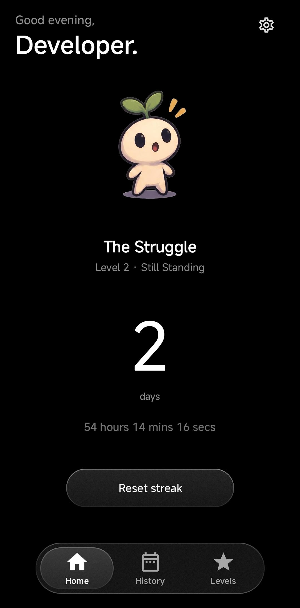
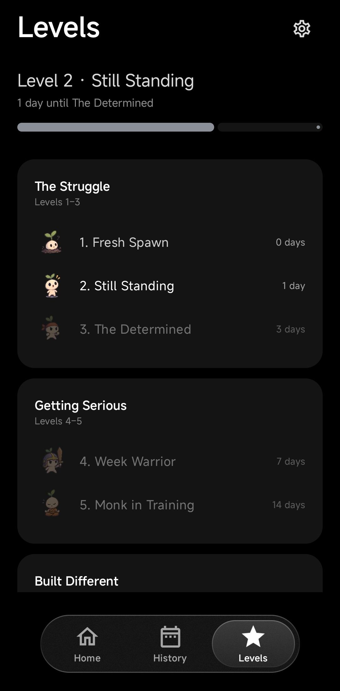
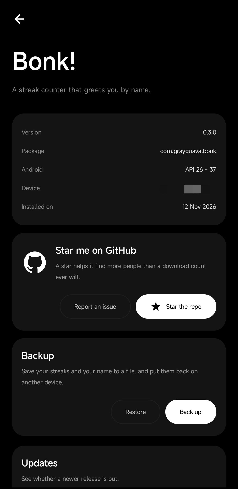

# Bonk!

**A streak counter that greets you by name.**

Bonk! is a small, deliberately quiet Android app for one job: keeping a streak alive. It shows
a number (how many whole days your current streak has run) and gets out of the way.

It is a simple abstinence tracker: a lightweight, quiet alternative to the
[NoFap App](https://play.google.com/store/apps/details?id=com.TasnimAnas.NoFap). No account,
no ads, no subscription, and nothing leaves the phone unless you ask it to.

## See it

<table>
  <tr>
    <td></td>
    <td></td>
    <td></td>
  </tr>
</table>

## What it does

- **A streak that runs on a timer.** Press *Start streak* and the clock begins; the counter is
  the number of whole days elapsed. Press *Reset streak* when it ends, and you have to say why.
  The reason is required, so the history means something later.
- **Ten levels in five tiers.** *The Struggle → Getting Serious → Built Different →
  Questionably Powerful → Final Form*, each level with its own character. The Levels tab
  tracks how far through the current level you are, to the second.
- **A history that remembers.** Every finished streak is a card: how long it lasted and why it
  ended. Tap it to see when it started and when it was reset.
- **A greeting that knows the time.** "Good morning," / "Late night," over your name, on the
  home screen only. Every other page names itself.
- **A backup you can carry.** The About page writes your name and every streak to a file you
  pick, and reads one back on another device.
- **An About page** with the app details, the device it is running on, and a link to the repo.
- **A check for updates.** The About page asks github for the newest release and downloads it
  only when you say yes. The download is checked against the checksum the release published
  before android is asked to install it.

## The tiers

| Tier | Levels |
| --- | --- |
| I · The Struggle | 1 Fresh Spawn (0 days) · 2 Still Standing (1) · 3 The Determined (3) |
| II · Getting Serious | 4 Week Warrior (7) · 5 Monk in Training (14) |
| III · Built Different | 6 Certified Monk (30) · 7 Bonk Resistant (60) |
| IV · Questionably Powerful | 8 Grass Toucher (90) · 9 Beyond Human (180) |
| V · Final Form | 10 The Bonkening (365) |

Each level has a character of its own. Full detail: [docs/tiers.md](docs/tiers.md).

## Installing

Grab an APK from the [releases page](https://github.com/grayguava/bonk/releases) and install it
(you will need to allow installs from your browser or file manager), or build it yourself:

```bash
adb install -r app-debug.apk
```

## Building from source

Requires **JDK 17 or newer** and the **Android SDK** (platform 37, build-tools 37). Nothing
else is required: no Android Studio needed.

```bash
export ANDROID_HOME="$HOME/Android/Sdk"     # wherever your SDK lives
./gradlew assembleDebug                     # -> app/build/outputs/apk/debug/app-debug.apk
adb install -r app/build/outputs/apk/debug/app-debug.apk
```

Other useful tasks:

```bash
./gradlew installDebug      # build and install on every connected device
./gradlew clean             # drop build output
./gradlew test              # unit tests
```

The debug build has its own application id, `com.grayguava.bonk.debug`, so it installs
alongside a release build of the same app instead of replacing it. Two builds signed with
different keys cannot upgrade one another, and this keeps that from biting.

If you prefer a GUI, the project opens in Android Studio (Meerkat or newer) and in IntelliJ
IDEA Community, which is considerably lighter.

The app is built with AGP 9 (which compiles Kotlin itself), Kotlin 2.4, Jetpack Compose and
Material 3. See [docs/architecture.md](docs/architecture.md) for how it all fits together.

## Releases

Each release is one signed APK that runs on any Android device from 8.0 up, with its
checksum beside it:

```
v0.2.1_universal.apk
v0.2.1_universal.apk.sha256
```

Download the APK from the releases page and install it, or build it yourself with the commands
above. `sha256sum -c v0.2.1_universal.apk.sha256` checks the download.

The About page also checks github for a newer release when you ask it to, and offers to install
it once you agree. That is the only thing the app ever sends over the network.

Maintainers: [docs/releasing.md](docs/releasing.md) covers how a release is made.

## Layout

```
app/src/main/java/com/grayguava/bonk/
  MainActivity.kt
  ui/          the screens, the dock, the glass material
  data/        streaks, levels, the name, backups, updates, and the app's voice
  ui/theme/    colour scheme and shapes
docs/          architecture, tiers, design notes, screenshots
```

## Contributing

Issues and pull requests are welcome. Keep the core UI calm: personality belongs in the
messages and the small surprises, not in extra screens. See [docs/design.md](docs/design.md)
for the rules the app follows.

## License

**GPL-3.0.** See [LICENSE](LICENSE).

The tab bar in `ui/BottomDock.kt` is derived from
[OpenTune](https://github.com/justshivv/Opentune), by the OpenTune contributors, under
GPL-3.0, the same licence as this app.
